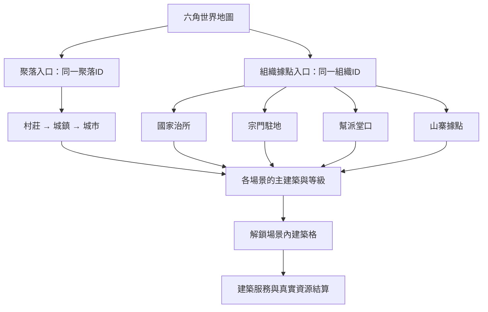

> 2026-10-23使用者已要求移除國家功能：國家類型、國家管轄層、國家治所與相關候選需求不再有效，也不列待確認。現行保留宗門／幫派／山寨的單層領地及聚落，共六類場景；下文國家與分層規則僅作歷史追溯，不得實作或恢復。詳見[移除驗收](國家功能移除_實作與驗收.md)。

# 2D場景製作方案：組織與聚落獨立場景

> 2026-10-21規格更新：舊國家與聚落方案已依使用者要求刪除，現以[聚落系統方案](聚落系統方案.md)為準。聚落改為人口達標並支付費用與材料後升級，影響力僅確認建造／供料來源、用途待定。下文早期人口自動升級、國家治理、稅制及影響力解鎖設計保留作歷史，不作新聚落實作依據。

更新：2026-10-18。本版依使用者最新需求重新評估，作為後續場景設計主文件。後續已依「先製作場景」完成獨立場景呈現首版；人口、主建築升級及政治仍為方案，實際範圍見下方實作更新。

## 1. 本次需求與設計結論

2026-10-18實作更新：使用者要求先製作場景，已建立七類色塊場景、獨立ID／主建築與格子呈現，以及世界格多入口；詳見[獨立場景首版驗收](獨立場景_首版實作與驗收.md)。下列人口、升級、內部施工與政治方案尚未因場景交付而實作。

已確認的新增方向：

- 每個組織都要有自己的獨立場景，包括國家、宗門、幫派與山寨。
- 村莊、城鎮、城市屬於同一聚落系列，隨人口成長發展、擴大，各聚落具有自己的獨立場景。
- 每個獨立場景都要有主建築；主建築等級控制新增建築格。
- 建築具有實際特殊功能，不能只有外觀或名稱。
- 已確認聚落成長同時擴大內部場景並占用相鄰六角格。
- 2026-10-21改為人口達標後支付固定費用與材料升級；是否連動主建築等級與工期待確認。
- 已確認各組織場景從世界地塊選單直接進入，第一版不以聚落內的組織入口為必要流程。

沿用已確認方向：俯視六角世界地圖、世界旅行後進入內部場景、先用色塊、點設施下指令、場景內移動作視覺呈現、國家管轄與地方領地可分層重疊。已確認人口採抽象居民、具名NPC另外計算，並確認相鄰格擴張優先序；人口增減公式、門檻、收益對象細節及政治分配仍待確認。

建議採兩層空間：**六角世界 → 組織／聚落內部場景 → 主建築與功能建築格**。六角格代表世界區域；建築格代表場景內用地，兩種格子的規則與容量分別記錄。

## 2. 現況與舊方案需要調整的地方

目前已有80格六角測試圖、五個據點、逐格旅行、分層初始領地、青雲宗色塊場景，以及在六角格上建藥園／煉丹房。最近驗收為149/149及四組Headless UI，詳見[六角首版實作](六角地圖_首版實作與驗收.md)。

這些驗收只代表既有首版，並未驗證人口成長、主建築升級或場景內建築格。以下需要改版：

| 舊設計 | 新方案 |
|---|---|
| 五個固定據點各做一張畫面 | 依每個組織／聚落建立獨立場景資料，可共用場景範本 |
| 一個六角格最多一棟主要建築 | 世界格放置據點入口；內部功能建築使用獨立建築格 |
| 青雲宗固定幾個建物按鈕 | 主建築、可解鎖建築格與實際建築實例驅動畫面 |
| 村莊只是地塊文字 | 同一聚落依人口與升級規則發展為村莊／城鎮／城市 |
| 場景只靠目前六角位置辨識 | 同時記錄世界位置與所在組織／聚落場景身分 |

「一格一棟」已確認的舊規則可作為**內部每個建築格一棟功能建築**的候選銜接；不直接把整個聚落限制為一棟建物。世界格可容納哪些入口及外部設施，需另行確認。現有舊情境不因文件變更而自動改寫。

## 3. 場景分類與入口

每個組織至少有一個獨立據點場景。同類兩個宗門可共用宗門場景範本，但必須具有不同SiteId、主建築、建築格及建物狀態。不能因共用範本而共用資料。分舵、多駐地與分都不是本次自動新增範圍。

聚落場景與組織場景是不同實體。例如青雲鎮有自己的聚落主建築；鎮內青雲幫堂口有幫派主建築。國家管轄某城鎮不代表兩者共用一個主建築或建築格。

世界地塊選單分別列出聚落與各組織入口，選取後進入對應SiteId。角色仍須抵達合法入口，不能從遠方任意傳送。同一格的多個入口不能混淆場景所有權；聚落升級也不會替同格組織升級主建築。

國家領土可以很大；國家獨立場景建議代表治所／王宮等核心據點，不將整個國境搬入一張內部地圖。國家據點的所在地與聚落關係待確認。

## 4. 聚落系列與人口成長

村莊、城鎮、城市使用同一SettlementId，改變的是發展階段、場景範圍、主建築等級及可用設施。升級不得建立另一份人口、市場或庫存，也不能讓原有任務、建造和旅行參照失效。

| 階段 | 場景發展方向 | 主建築候選 | 候選設施方向 |
|---|---|---|---|
| 村莊 | 少量居住與公共活動空間 | 村務所 | 基礎集市、委託入口 |
| 城鎮 | 擴大街區與功能分區 | 鎮公所 | 正式市場、公共服務 |
| 城市 | 更多街區與可用建築格 | 城政廳 | 較完整公共設施 |

表內建築名稱與效果都是候選。房屋、糧食、稅收、治安、生育或人口憑空生成，不因人口需求而自動新增。

### 人口如何計算

已確認採抽象居民人口，具名NPC另外計算。各聚落保存自己的ResidentPopulation；具名NPC數量與角色位置另行統計，不再以具名角色居籍人數推導居民人口，也不因畫面生成人物就增加居民。

建議UI分別顯示「抽象居民人口」「具名NPC」，不直接相加成一個未定義的總人口。升階採哪個人口口徑仍須在規則中明定，推薦候選以抽象居民人口為準；同一具名NPC不得又被隱含計入居民基數而重複統計。

抽象人口的初值、成長／減少來源、更新週期與升級門檻尚未確認。不得自行加入生育、糧食、住宅或生成大量具名NPC。聚落升階、占地及場景顯示共用同一人口狀態，不另複製人口。

### 人口、聚落階段與主建築的關係

已確認：聚落人口達門檻 → 核心於固定Tick檢查 → 自動提升聚落階段與聚落主建築等級 → 解鎖對應建築格、擴大內部場景，並處理相鄰世界占地。此流程不要求玩家點升級按鈕，也不因畫面載入次數而重複執行。

人口門檻使用待訂的P_城鎮、P_城市，本文不硬定數字。不擅自新增自動升階費用；功能建築仍沿用各自建造成本。人口下降後建議先保留建物，不自動刪除格子或強迫降級；是否停用部分服務與降級另議。組織場景的主建築升級條件獨立設定，不擅自套用聚落人口門檻。

已確認內部場景與世界占地都擴大。聚落以穩定錨點及Footprint記錄連通占地，新格加入同一SettlementId，不能各自建立第二個聚落或人口帳戶。增加占地不自動轉讓國家／地方組織領地；土地權利與占地屬性分開保留，擴張排序見下節；不足時的處理仍待確認。

擴張按下節已確認的土地優先序處理，不再一律排除組織持有但未建築的格子。多聚落同Tick爭用相鄰格須原子提交，不能重疊或穿越不連通格。占地規模表與同級選格方向待訂。人口升階時無合法空間的處理仍需另訂；不得偷偷吞併土地或降低已確認的自動升級要求。

### 聚落是可爭取的地塊資源

使用者已確認聚落本質為地塊屬性，是國家與各組織需要爭取的資源地塊。多格聚落由同一SettlementId串接，主建築所在格為核心，其餘為附屬格；內部場景只是這份聚落狀態的呈現，不成為另一個領地持有者。

已確認相鄰候選格的優先序：

| 優先級 | 地塊條件 | 擴張處理 |
|---|---|---|
| 1 | 無主地塊 | 優先加入聚落占地；分類候選為無國家管轄且無地方組織持有 |
| 2 | 國家地塊 | 無主格不足時選用；國家與地方重疊時依地方持有及建築條件再判定 |
| 3 | 組織未建築地塊 | 前兩類不足時選用；加入聚落屬性不默默轉移該格組織持有權 |
| 禁止 | 組織已建立建築的地塊 | 不得占用，不得為湊擴張面積刪除或搬走建築 |

排序只作用於可達、相鄰且合法的格子，不能因優先級較高就跨越不連通地塊。相同優先級的方向、距離、占地數、建造中保留格與其他聚落占地的衝突細則仍待訂；不自動推出徵收、征服或外交玩法。

### 統治、管理與聚落歸屬

已確認「國家境內由國家統治、組織境內由組織管理」。國家管轄與地方管理可同時存在；主建築決定的聚落歸屬，與附屬格所屬組織不能合併為單一Owner欄位。

| 情況 | 已確認歸屬方向 |
|---|---|
| 主建築由組織建立 | 聚落歸該組織；位於國境內仍保留國家管轄層 |
| 無組織建立來源，聚落位於國家境內 | 歸該國家 |
| 無主聚落且不在國家境內 | 沒有聚落歸屬；不能為了方便管理自動建立虛構組織 |

需保存主建築建立來源，不能因自動升級、更換外觀或人口變動而重設建立者。主建築後續轉手、國境變化、多國跨界占地與誰能在無主聚落建造等細則仍待確認。

### 地塊收益與政治系統的界線

2026-10-19已確認：移除附屬地塊全部收益規則，改為該地塊上組織建築生產的稅後收益歸該建築所屬組織；持有地塊不代表取得整格收益。影響力僅解鎖資格，建造另須土地使用權。首都保留城鎮大廳，皇宮另為國家主建築；採石場必須有石料礦點。稅率、分成及維護細則仍待確認，尚未實作。

聚落內政治系統用以劃分各國家／組織的收益分配與維護支出，使用者明確指定**政治系統待確認**。本次只保留需求與資料邊界，不設定稅率、分紅比例、維護額、選舉或官職，也不在政治規則缺失時產生虛構收入或自動扣款。

資料應分開追蹤收入來源格、收入類型、實際接收者及維護支出承擔者；「地塊收益」「建築產出」「私人交易所得」不能擅自當作同一筆收入。已有角色／宗門帳本規則維持原樣，政治結算實作前需先確認收益範圍與分配口徑。

## 5. 主建築與可解鎖建築格

每個場景保留一個固定主建築位。主建築本身不占可解鎖功能格，避免升級時沒有空格而卡住。主建築被拆除、損毀與重建規則未定，首版建議不提供拆除主建築。

候選容量示例：

| 主建築等級 | 可用功能建築格（示例） | 畫面表現 |
|---|---:|---|
| L1 | 4 | 核心院落／小型街區 |
| L2 | 8 | 開放外圍空地與街道 |
| L3 | 12 | 擴展第二區功能用地 |

4／8／12僅供評估，不是已確認平衡。各場景類型可使用不同解鎖表；不能每類硬套同一最大等級。

建築格以SiteId＋SlotId穩定識別，記錄位置、解鎖等級與使用限制。尚未解鎖、可建、施工中、營運中須能從畫面辨識。升級只解鎖既有穩定ID的格子，不重排SlotId或清空已有建築。

聚落主建築由人口規則自動升級，必須以聚落ID及目標等級防重複解鎖，不另套手動施工排程。組織主建築的升級方式仍待確認；若採付費施工，才套用共用驗證、資源保留及排程。同一主建築不能重複排隊升級或重複扣款。功能建築建造的既有靈石／工期／取消規則維持原確認，不等同聚落自動升階。

## 6. 建築的特殊功能

每棟功能建築要連接真實服務、前置條件與消耗，不把「放了建築模型」算成特殊功能完成。

| 場景 | 主建築候選 | 優先可接既有功能 | 新特殊功能候選，待確認 |
|---|---|---|---|
| 國家據點 | 官署／王宮 | 招募、政策、組織任務 | 行政職權、國家公共建設；稅制與軍隊另議 |
| 宗門 | 宗門大殿 | 藥園、煉丹、貢獻兌換、任務 | 功法傳承或修煉場所的具體效果另訂 |
| 幫派 | 幫派總堂 | 招募、成員委託 | 情報服務、商務協作；不預設全知情報或免費資源 |
| 山寨 | 山寨議事堂 | 成員任務、物資管理 | 哨所／巡守；不自動加入劫掠或敵對規則 |
| 聚落 | 村務所→鎮公所→城政廳 | 當地市場、委託入口 | 各級公共服務及人口容量作用另訂 |

建築定義建議包含ServiceIds、適用場景／組織類型、主建築前置等級、建材／費用、工期、使用者權限與服務規則。只有已完工、所屬權限有效且條件滿足時，服務才能使用。

建議第一批只整合已有的煉丹、採藥、兌換及市場，之後逐項確認新增功能。每種新效果都應寫明：對誰有效、何時生效、消耗什麼、結果如何追蹤、能否疊加。本文不新增數值加成或配方。

可供確認的功能規格示例：

| 建築 | 特殊功用候選 | 真實結果與限制 |
|---|---|---|
| 宗門煉丹房 | 開放已接宗門工作的角色煉丹 | 扣宗門原料，依真實成功率產出至宗門；失敗消耗、貢獻報酬沿用既有規則 |
| 宗門兌換處 | 成員用貢獻兌換宗門庫存 | 扣點及實際商品轉移，不允許反向換靈石、不複製庫存 |
| 聚落市場 | 提供該聚落可取得的實際買賣報價 | 每個聚落分別對應市場帳戶與庫存；商店未啟用時不冒出成交 |
| 國家官署 | 核發受管聚落的建造管理權 | 建立可驗證的管理授權，不等於轉移地方組織財產；此新權限功能待確認 |
| 幫派委託所 | 發布限合格成員接取的委託 | 保留幫派預算，實際交付後付款；特殊任務種類另訂 |
| 山寨物資庫 | 依組織政策接受上繳與批准申領 | 每筆在角色與山寨帳戶間轉移；不是免費補給或額外資源池，此申領功能待確認 |

功能效果與建築存在要連動：未建成不能使用、同一服務多棟是否增加容量要另訂。上表後三類並未因列為方案而實作。

## 7. 庫存、治理與控制權

組織資產仍以OrganizationId為權威持有者；聚落市場依SettlementId／MarketId識別。場景保存獨立建物與格子資料，但不能再複製一份相同組織庫存。多個組織進入同一城鎮，庫存也不能合併。

國家管轄、地方領地、聚落管理權、組織據點所有權各自記錄。聚落主建築按已確認的人口規則自動升級，聚落功能建築由誰下令、使用哪個預算仍待確認；不能因玩家站在城內或是某幫派首領，就取得整座城的建造權。

玩家仍只控制自己的角色；組織權限來自身分與職位，其他角色自主決策。NPC接受工作後前往正確場景與設施，不能只到同一六角格就視為可使用所有建物。

世界在切換場景時持續依原時間操作運行，關閉遊戲不推進。載入、點建物或動畫結束不直接增加人口、完成升級或產出資源。

## 8. 核心資料與Godot顯示建議

以下均為擬新增／調整，尚未實作：

| 資料 | 責任 |
|---|---|
| SettlementState | 穩定聚落ID、階段、主建築所在格、占地、主建築產生者、聚落歸屬與抽象人口 |
| SiteState | 場景ID、組織／聚落歸屬、入口、範本與主建築ID |
| MainBuilding／BuildingState | 建物ID、等級、升級／建造狀態、服務與保留資源 |
| BuildingSlotState | 場景內穩定SlotId、解鎖等級、建造限制與占用者 |
| CharacterLocation | 世界位置＋所在SiteId；保留場景間位置與旅行狀態 |
| PopulationState／PopulationChange | 抽象居民人口、增減來源與週期；具名NPC分開統計，不以角色數推導居民數 |
| 地塊聚落屬性／領地權利 | 同一格的SettlementId、國家統治與地方組織持有／管理分開，擴張不覆寫權利 |
| 主建築建立來源／聚落歸屬 | 建立者類型與ID、聚落歸屬及無主狀態；自動升階保留來源 |
| 收益來源紀錄（政治待確認） | 來源格、收益類型與接收者；組織建築生產的稅後收益接收者為該建築所屬組織，原整格收益規則已移除，其他分配及維護未定，不新增自動結算 |

建築位置應明確區分WorldHex與SiteSlot，避免同一建築同時占一格世界與一格內部容量。主建築等級只保留一個權威來源，避免Site與Building各記不同等級。

Godot使用聚落、國家、宗門、幫派、山寨場景範本與獨立資料實例。畫面載入範本後依SiteId綁定主建築、已解鎖格與角色，離開則釋放顯示物件；遠方場景的核心資料與排程仍保留。每個組織有獨立場景不代表所有場景同時建立Node，也不要求手工複製每個組織一份.tscn。

玩家抵達世界錨點後才可進場景；同一世界格內進不同場景仍要驗證入口與權限。切換時清除舊UI訂閱與選取狀態，避免從甲宗門畫面提交到乙宗門。

延續1000×700與色塊原型。HUD保留時間、玩家狀態與世界／內部返回操作；場景內建造模式顯示SlotId對應位置、解鎖條件及成本，正常遊玩時以建築名稱及可用服務為主。

## 9. 與現有藥園／煉丹房、存檔的銜接

目前藥園／煉丹房是獨立世界位置且需旅行。新方案必須明確選擇哪些設施移進組織場景、哪些仍是外部資源據點；不能只把畫面移進去就取消原旅行規則，或保留兩份建築產出。

推薦候選：宗門內煉丹房使用內部建築格；外部天然採藥地保留世界資源點。藥園是否也成為內部設施已列待確認。不得把「內部藥園」逕自變成新增種植系統。

新資料應在後續實作時評估存檔版本升級。既有schema3存檔先保留原模式；若提供轉換，需映射世界建築到SiteSlot、補主建築與格子、補抽象人口初值及具名NPC統計，並轉換進行中旅行／施工。來源檔不覆寫，不自動分配新庫存或捏造居民。主建築升級中存讀，進度、保留款與解鎖結果須一致。

## 10. 實作順序與驗收

這是新需求的候選拆分，尚未實作；不將既有已驗收首版退回為回歸失敗。

| 編號 | 範圍 | 核心完成條件 |
|---|---|---|
| SITE-01 | 獨立場景身分與範本 | 同類兩組織資料隔離、同一世界格可辨識不同入口、場景切換不複製庫存 |
| SITE-02 | 主建築與內部建築格 | 等級解鎖、鎖格拒絕、占格防重複；組織升級若採施工則驗證資源／取消，聚落自動升階驗證一次解鎖及存讀一致 |
| SITE-03 | 宗門既有工作遷接 | 藥園／煉丹房位置定案後接線，玩家／NPC資格及真實產出一致 |
| SITE-04 | 聚落屬性、抽象人口與占地 | 村→鎮→城保留ID、居民與具名NPC分開、擴張排序／建築禁占、歸屬／升級／解鎖可重現 |
| SITE-05 | 四類組織場景與功能 | 每類場景含主建築、獨立格子，已確認的特殊服務逐項驗收 |
| SITE-06 | 人工與效能整合 | UI防穿透、反覆切換無洩漏、畫面擴大可讀、有視窗FPS與Tick實測 |

建議先以青雲宗及第二個宗門驗證隔離，再接一個可由村莊成長的聚落；其後完成其他組織範本。第二個宗門是驗收資料，不代表新增宗門外交玩法。

人口成長、聚落升級、主建築升級三者需分別測試；其他必要案例包括未授權角色建造／操作組織升級、多人競爭同格、重複退款、跨場景指令、讀檔後重複解鎖、人口下降處理符合確認規則，以及世界地塊與內部建築格不重複占用。

## 11. 待確認與本次交付

已確認世界與內部同時擴大、人口自動升級聚落與主建築、世界地塊選單直入組織場景，以及抽象人口和擴張優先序。附屬格上組織建築生產的稅後收益歸該建築所屬組織，原整格收益規則已移除。其餘見[2D場景待確認問題](2D場景_待確認問題.md)。統治與管理按國家／組織境內區分，主建築來源決定聚落歸屬；政治系統、組織主建築升級條件與各建築特殊效果仍待確認，不作已定規格。

本次只更新方案、相關文件與進度，不修改程式或存檔。未執行程式建置及測試；新場景系統、人口與主建築解鎖均未驗證。既有青雲宗／六角首版驗收保留為歷史證據，不能直接當作新需求驗收。

