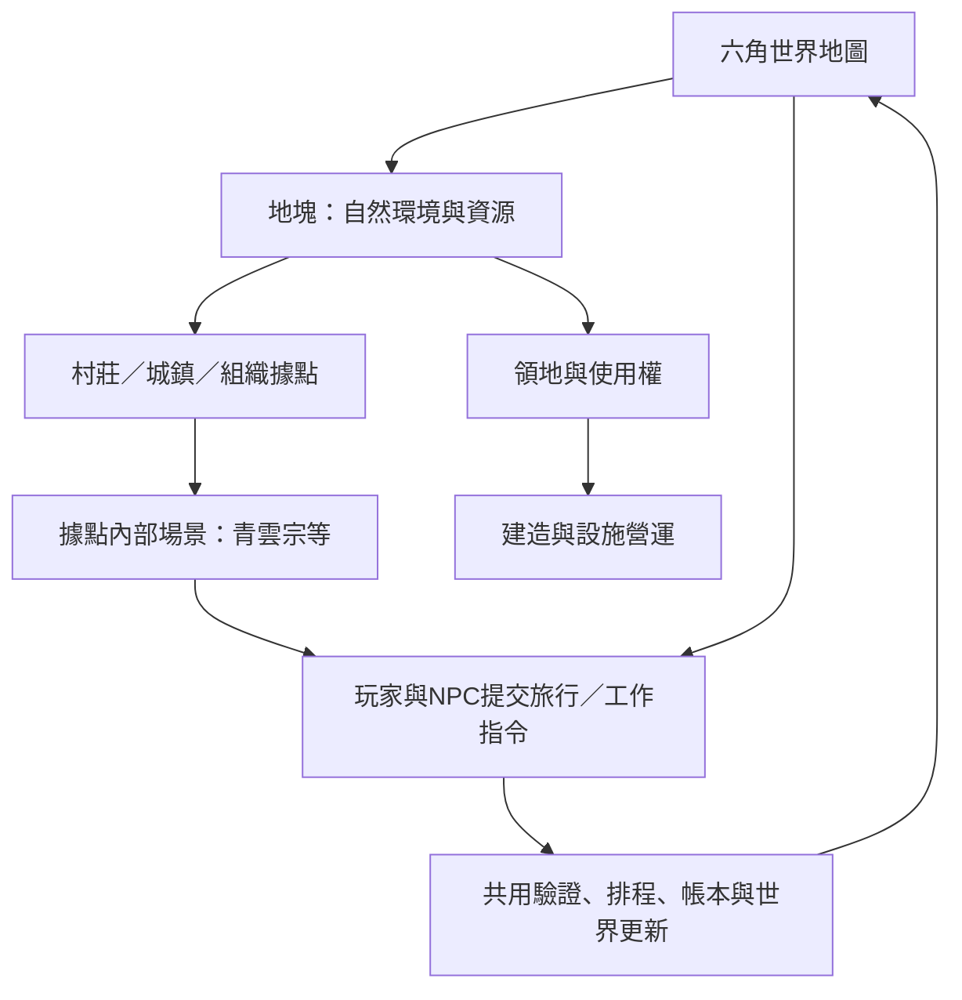

> 2026-10-23使用者已要求移除國家功能：國家類型、國家管轄層、國家治所與相關候選需求不再有效，也不列待確認。現行保留宗門／幫派／山寨的單層領地及聚落，共六類場景；下文國家與分層規則僅作歷史追溯，不得實作或恢復。詳見[移除驗收](國家功能移除_實作與驗收.md)。

# 俯視六角地圖、組織領地與特色建築方案

> 2026-10-21規格更新：舊國家與聚落方案已依使用者要求刪除，現以[聚落系統方案](聚落系統方案.md)為準。聚落改為人口達標並支付費用與材料後升級，影響力僅確認建造／供料來源、用途待定。下文早期人口自動升級、國家治理、稅制及影響力解鎖設計保留作歷史，不作新聚落實作依據。

更新：2026-10-17。後續使用者已授權實作，首版六角地圖、初始領地、旅行與宗門建造已建立；範圍與驗收詳見 [首版實作紀錄](六角地圖_首版實作與驗收.md)。下列保留完整方案脈絡，候選功能不代表均已完成。

最新需求重評：每個組織及聚落需有獨立內部場景與主建築，內部建築格依主建築等級解鎖；村莊→城鎮→城市依人口達標自動升階，連同聚落主建築升級，並擴大內部與相鄰世界占地。組織入口由世界地塊選單直接進入。新版空間與人口設計以[2D場景主方案](2D場景製作方案.md)為準；以下世界格一棟建物是既有首版範圍，不再作為內部場景的容量規則。新需求目前僅完成文件，未改程式。

2026-10-18確認：聚落是地塊屬性與可爭取的資源，居民採抽象人口、具名NPC另計。擴張順序為無主格＞國家格＞組織未建築格，禁止占用組織已建築格。統治／管理分層，聚落歸屬按主建築建立來源及國家境內規則判定；附屬格收益與主建築歸屬分開。政治系統明確待確認，不加入稅率、收益分成或維護扣款，細節統一見2D主方案。

## 1. 已確認方向與尚待確認範圍

使用者本次明確提出：

- 世界地圖使用俯視角六角地塊；視覺方向可參考《文明帝國6》，實際操作與規則依本專案另訂。
- 自然環境包含山脈、湖、森林、平原、沙漠等；人造內容包含村莊、城鎮等。
- 組織包含國家、宗門、幫派、山寨，各自具有核心功能。
- 組織領地由地塊構成，組織發展時可在自己的地塊興建特色建築。
- 已確認允許國家管轄與地方組織領地分層重疊。
- 已確認六角地圖用於旅行，進入據點後開啟內部場景。
- 已確認首版先配置初始領地，完成建造後再規劃擴張；首版不加入取得新領地的操作。

後續使用者已另確認聚落人口成長占用相鄰六角格；這是聚落Footprint的新需求，與組織領地徵服／擴張分別規劃。聚落占地不得默默變更國家與地方領地所有權。

本文推薦的尺寸、座標表示、建築種類、成本、細部權限及後續擴張流程仍屬候選設計；分層領地、內外場景銜接與首版固定初始領地已確認。沒有指定的數值不視為已確認。參考方向不代表沿用其他遊戲的完整玩法，也不代表世界改為回合制。

### 既有系統的銜接限制（規劃時基線）

目前 `DemoMap` 只有五個位置 ID 與固定 Tick 旅行，角色沒有六角座標。`OrganizationState` 只有 ID、名稱、首領與地區，尚無組織類型、領地或建築。宗門設施已有材料、產出、工作資格與貢獻規則；青雲宗已有色塊場景，但只是既有宗門據點的視覺呈現。

新方案涉及核心位置、旅行、組織、AI、存檔與呈現層，不可僅替換背景圖便宣稱完成。舊 Demo 與驗收應保留，正式六角世界另建測試情境。

## 2. 建議整體結構

已確認採「六角世界地圖＋據點內部場景」。世界地圖處理遠行、地形、領地及建築分布；進入據點後開啟青雲宗等內部場景。

角色在世界地圖逐格旅行；場景內移動仍可沿用已確認的視覺表現。兩者使用同一角色、同一份庫存與同一模擬時間，切換畫面不額外傳送或推進時間。

## 3. 地塊資料：環境、聚落與領地分開

不將所有內容塞進一個互斥的「地塊種類」。建議如下：

| 資料層 | 候選內容 | 用途 |
|---|---|---|
| 基礎地表 | 平原、沙漠、湖泊 | 決定基礎通行與建造適用性 |
| 地勢 | 平坦、丘陵、山脈 | 表達高低差、山地通行限制 |
| 自然覆蓋 | 無、森林 | 允許森林位於平地或山地，並保留採集條件 |
| 資源點 | 草藥、既有副本入口等 | 連接實際資源池與行動；新增木材、礦產另議 |
| 聚落 | 無、村莊、城鎮 | 表達人造聚落，與所屬組織分開 |
| 建築實例 | 藥園、煉丹房等 | 儲存擁有者、位置、建造及營運狀態 |
| 組織權利 | 管轄、領有、使用許可 | 決定誰可建造、使用及取得產出 |

例如「平原＋森林＋村莊」可同時存在。建造是否清除森林、是否允許山地聚落，須由規則明確決定；首版建議不實作地形改造。

### 自然地塊候選規則

| 類型 | 首版通行候選 | 建造候選 | 經濟用途 |
|---|---|---|---|
| 平原 | 可通行，基準成本 | 村鎮、一般設施 | 適合作為起始活動區 |
| 森林 | 可通行，成本高於平原 | 需建築明確允許 | 連接現有草藥或副本事件，並非每格無限產出 |
| 山脈 | 首版不可通行，或僅設定通道 | 僅明確允許的建築 | 宗門／山寨選址可用山腳或通道旁，不強迫角色穿山 |
| 湖泊 | 首版不可通行 | 不建一般陸地建築 | 作為地理阻隔；船運、漁業待確認 |
| 沙漠 | 可通行，成本高於平原 | 依建築條件 | 首版只影響通行及選址，不另增口渴或生存系統 |

地形成本、採集產出、再生與建造條件均資料化，不在畫面腳本硬編。不得讓湖泊與高山組合堵死全部起始據點。

## 4. 六角座標、旅行與視覺

建議核心使用軸向座標 `(q, r)`，地圖 ID 與座標共同識別地塊；畫面暫採尖頂六角候選。核心只處理相鄰關係與成本，Godot 負責座標轉像素、選取、鏡頭平移與縮放。

- 六方向鄰格：`(1,0)、(1,-1)、(0,-1)、(-1,0)、(-1,1)、(0,1)`。
- 路徑距離可由六角座標計算；實際旅行時間還須套用通行與地形成本。
- 候選使用 A* 計算合法路徑；穩定的鄰格與同分排序讓同輸入可重現。
- 每一步以整數 Tick 排程，角色只能在該步完成後到達下一格；動畫只插值呈現。
- 存檔記錄目前地塊、剩餘路徑與下一步到達 Tick，讀檔不重置進度。
- 路徑變得不可走時，在下一步提交前重驗並中止／重新規劃；不穿越失效邊界。
- 不能把 NPC 未知的資源、邊界或價格直接交給決策器；可用資訊來源與記憶仍需沿用既有約束。

首版候選：有限、不環繞的小型固定測試地圖，先驗證六角選取與路徑，再決定程序生成。地圖尺寸、每格代表距離與耗時尚待確認，本文不給未量測容量承諾。

## 5. 組織共用能力與類型差異

共用底層保留組織 ID、成員、首領／職位、庫存、預算、任務、政策、領地及建築清單。以類型設定開放不同核心服務與特色建築，避免為四種組織複製四套帳本與任務系統。

| 類型 | 核心定位候選 | 特色建築候選 | 第一版邊界 |
|---|---|---|---|
| 國家 | 聚落治理、領地管理、公共任務 | 官署、公共倉庫、關隘 | 先驗證管轄與建造資格；稅制、軍隊、外交不自動加入 |
| 宗門 | 修煉傳承、宗門生產、弟子工作與貢獻 | 宗門大殿、藥園、煉丹房 | 優先接現有工作、庫存及兌換流程；傳承加成另訂 |
| 幫派 | 城鎮據點、成員協作、地方委託 | 幫派堂口、委託所 | 可使用共用招募／任務；商路、保護費與新交易優惠另議 |
| 山寨 | 山林據點、成員集結、物資管理 | 山寨議事堂、物資庫、哨所 | 先呈現領地與設施；劫掠與自動敵對另議 |

以上建築名稱與專屬效果待確認，不表示已存在。山寨、山匪怪物與一般角色不是同一概念：現有副本山匪不能直接當作有組織、領地與持續生命週期的 NPC。幫派也不必預設全部敵對。

## 6. 領地模型與擴張

### 領地模型比較與選定結果

| 方案 | 定義 | 適用情境與代價 |
|---|---|---|
| A：單一領有 | 每格最多一個領有組織 | 首版易驗證；國家境內宗門需改以許可設施表達，無法同時表達兩層領地 |
| B：分層權利 | 國家管轄與地方組織領地分開記錄 | 可表達國境內宗門／幫派；須增加建造、通行及產出權限衝突規則 |

使用者已選定 B：國家管轄與地方組織領地允許分層重疊。A 僅保留為方案比較，不作實作方向。不能用一個 `OwnerId` 同時代表國家、宗門與建築持有者。兩層的建造、通行及產出權限衝突仍須另訂。

候選首版不允許同一層級兩組織同時領有同格。國家管轄變更不自動轉移宗門建物或庫存；每筆移轉都須有明確行動與帳本。地圖邊界、成員歸屬及建築擁有者是不同資料。

### 領地取得方式

1. 首版已確認配置固定初始領地，先完成邊界、建造與營運，不提供領地擴張指令。
2. 完成建造後才另行規劃擴張。和平取得相鄰無主地僅保留為後續候選；相鄰／可達條件、管轄許可、費用與競爭順序屆時再確認，不納入首版驗收。
3. 交易割讓、征服、圍城、外交與領地爭議另列待確認，不作首版必做。

是否允許飛地、跨湖擴張、山脈／湖泊算入領地、領地有無上限，均須確認。領地不應只憑鏡頭畫出的顏色判定。

## 7. 建造、營運與經濟一致性

建築定義候選欄位：允許的組織類型、適用地形、前置條件、占格規則、材料／靈石成本、工期、提供服務及使用資格。建築實例記錄 ID、組織 ID、地塊、狀態與建造排程。

建造流程：具權限角色提出計畫 → 驗證領地／許可、槽位、材料與資金 → 原子保留資源及位置 → 排程施工 → 完工啟用服務。

- 已驗收舊首版每個世界格一個建築槽。新場景需求改由各場景主建築等級解鎖內部建築格；世界格、聚落占地與內部建築格分別建模，具體格數待訂。
- 已確認只耗組織靈石、抽象 Tick 工期，開工保留、完工消耗，完工前取消全額退回保留款；暫不新增木材／石材供應鏈。
- 若需真實工人，必須透過 NPC 自主接取建造工作；不能用玩家點建築直接控制其他角色。首版是否採抽象工期另問。
- 建造中失去領地／許可時，候選為停工並禁止重複占位，之後取消或復工；不無條件退款或瞬間易主。
- 建築不是永久免費資源來源：生產仍要材料、時間與操作資格。維護費、耐久與升級另議。
- 工作產出、兌換與收購使用組織原有庫存；首版不新增每棟建築的獨立倉儲與運輸鏈。
- 領地權不等於個人財產權；不能因角色路過就扣稅或轉移其物品。

現有藥園／煉丹房可先映射到已完成建築，延續接工作才能使用、宗門供料與持有產出等規則。新建築解鎖現有服務，新增服務另行確認。靈石可直接沿用；木材、石材若要作建材，須同時規劃來源與消耗，不能只新增需求造成經濟停擺。

## 8. AI、權限與情報

組織首領或有授權職位才可發起領地與建造決策，成員仍自主選擇工作。候選組織決策依既有庫存短缺、需求、可用地、可負擔成本與風險排序，不保證所有組織以相同順序發展。

NPC 只使用可得的地圖與組織資訊；組織內部庫存能否共享給成員須有權限來源。未知市場不能因六角地圖載入就成為全知價格。規劃可以低頻／事件觸發，不能每 Tick 對所有角色搜尋整張地圖。

UI 顯示建造條件與拒絕原因；玩家即使看到國家領地，也不能操作非自己角色權限下的組織。場景查詢不直接改寫世界。

## 9. 技術拆分、設定與存檔

| 模組 | 擬新增責任 |
|---|---|
| Domain | HexCoord、地塊、聚落、組織類型、領地權利、建築定義與實例 |
| Simulation／Systems | 旅行逐格提交、領地變更、建造排程、共用驗證與帳本 |
| AI | 已知路網查詢、旅行計畫、組織建造候選評估 |
| Presentation | 六角繪圖、地塊選取、地形／領地圖層、建築資訊及據點場景入口 |
| Persistence | 地圖與建築狀態、旅行進度、規則快照及版本遷移 |

建議設定分類（均未建立）：`config/map/terrains.json`、`movement.json`、`generation.json`；`config/organizations/types.json`、`territory-rules.json`；`config/buildings/definitions.json`。命名依現有載入慣例調整，不在此階段搬動舊設定。

新存檔保存地圖生成種子、生成器版本及實際地圖／差異資料，不能只保存種子卻忽略演算法改版。使用中的規則依現有存檔快照策略保存；畫面偏好可與世界狀態分開。

舊檔候選先保留 Demo 模式；建立六角新世界時才啟用新地圖。若要轉換舊檔，必須先定義五個據點的確切座標、設施映射與進行中旅行轉換，不自行猜測或覆寫來源檔。

效能以地塊／區域／組織索引查詢；只繪製視野地塊，邊界變更後局部重建。路徑快取須含地形與權限版本，避免沿用失效路線。測試須同時記錄地圖大小、地塊變更、可見角色與總 NPC 數；既有 Headless 成績不能代替這次驗收。

## 10. 候選開發順序與驗收

以下為方案拆分；HEX-01～03、ORG-01 與 BLD-01 已有首版實作，實際驗收狀態以總表為準。BLD-02 特色功能仍待確認，HEX-04 人工視覺與容量量測未完成；不重開已結案階段。

| 編號 | 工作 | 完成條件 |
|---|---|---|
| HEX-01 | 固定六角地圖與自然圖層 | 六鄰格、點選、縮放、地形組合及固定資料可重現 |
| HEX-02 | 聚落與五據點映射 | 不重複庫存／角色，正確開啟既有青雲宗場景 |
| HEX-03 | 逐格旅行與存讀 | 地形成本、不可達判定、途中存讀及路線失效處理一致 |
| ORG-01 | 組織類型與初始領地 | 四種類型可共用組織規則，領地層級及權限衝突測試通過 |
| BLD-01 | 宗門建築與既有服務 | 合法選址、費用／槽位保留、完工／取消、防重放與工作產出一致 |
| BLD-02 | 四類特色建築 | 只實作已確認的各類核心功能；逐項列驗收，不以名稱／空殼代表完成 |
| HEX-04 | 整合與有視窗量測 | 角色自主活動、旅行／建造存讀、經濟稽核、渲染與Tick實測 |

建議第一個可玩切片：固定小地圖包含五類自然環境、村莊／城鎮標記與青雲宗；配置宗門初始領地，映射既有藥園／煉丹房，驗證旅行與工作循環。其他組織先定義資料與展示領地，待其核心功能定案後才宣稱可玩。

必要測試包含：同格重複建造競爭、越界建造、資源不足、成員無權操作、取消／完工重放、領地變更途中停工、地形不可達、旅行途中讀檔、內外場景同一狀態、NPC資訊受限，以及世界時間不依畫面幀率。

## 11. 待確認與交付狀態

優先決策及其他問題見 [六角地圖待確認問題](六角地圖_待確認問題.md)。三項優先決策與首版建造細則已確認；使用者後續另授權實作。地圖尺度與通行成本目前採設定檔測試值，最終平衡仍待確認。

首版已有程式、設定與 schema3 遷移，詳見實作紀錄；其他提案不自動轉為必做功能。程序生成、四類組織全部特色功能、人工視覺及大型地圖效能並未因此宣稱通過。

### 2026-10-18：城鎮附屬地塊收益確認

2026-10-19已確認：移除附屬地塊全部收益規則，改為該地塊上組織建築生產的稅後收益歸該建築所屬組織；持有地塊不代表取得整格收益。影響力僅解鎖資格，建造另須土地使用權。首都保留城鎮大廳，皇宮另為國家主建築；採石場必須有石料礦點。稅率、分成及維護細則仍待確認，尚未實作。

2026-10-19新增：[國家與聚落治理方案](聚落系統方案.md)補充多聚落、人口建材、稅務與影響力。舊版未包含的內容現先規劃；收益規則已於2026-10-19確認更新；稅率及分成待確認，尚未實作。
