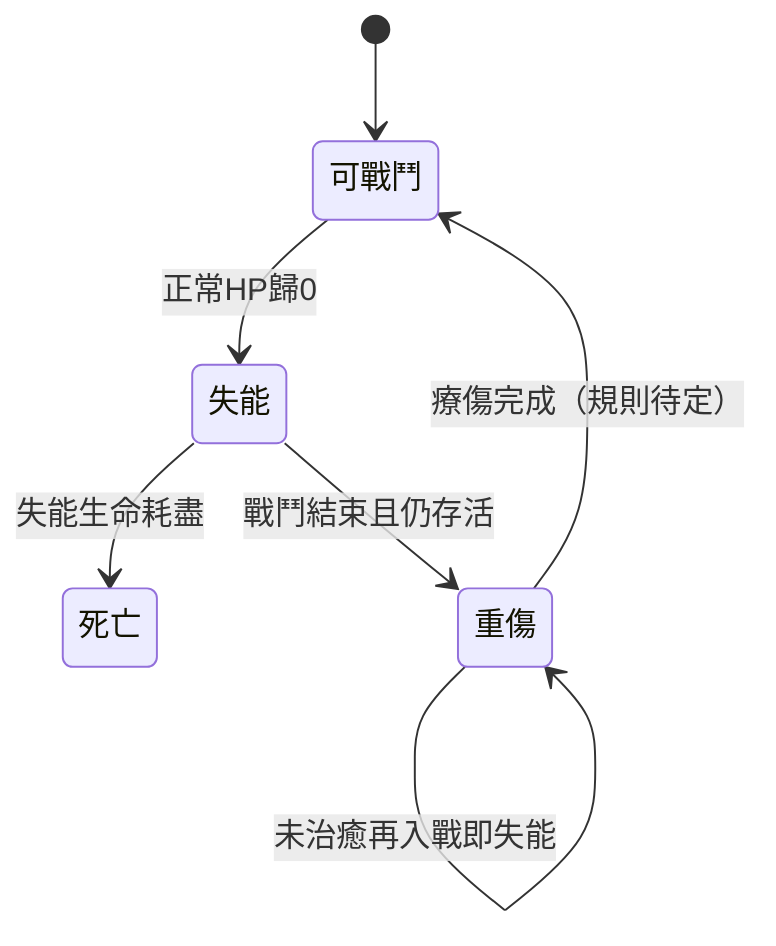

# 戰鬥系統：雙5×5陣地回合制方案

時間需求更新（2026-10-18）：使用者已確認玩家戰鬥停止世界時間、戰鬥輪獨立推進，NPC對NPC直接結算；這取代原方案將世界Tick與戰鬥Round綁定的方向，但程式尚未改版。見[時間方案](時間系統_年度行動點與戰鬥時間方案.md)。下文原Tick規則為先前方案／驗收背景，不能當作新時間規則已完成。

後續進度（2026-10-18）：首版規則已確認，並完成獨立可玩雙陣地／普攻流程；見[首版與驗收](階段7_雙陣地首版與驗收.md)。下文尚未實作的描述保留原方案／模型批次當時紀錄，現況以首版驗收及統一進度總表為準。

日期：2026-10-18。本次依使用者草案補齊設計，不修改程式、設定或存檔。已確認方向與候選規則分開記錄。

## 1. 已確認方向與規格變更

- 雙方各自一個5×5正方形戰鬥陣地，**每方最多5人，不可跨入敵方陣地**。
- 採回合制，以先攻決定出手順序；先攻一般受速度主導，技能可修正。
- 正常生命歸0即失去戰鬥能力，取得10%額外血量；已另確認須將這份血量耗盡才死亡，可能承受多次攻擊。
- 戰中未死亡的失能者，戰後進入重傷；重傷未治癒再進戰鬥時失去戰鬥能力，須療傷才恢復。
- 非致死勝利可指定戰利品，已確認限敗方可掉落清單及數量／價值上限，不能搬走全部財產。
- 死亡時隨機取得戰利品；與非致死選取分開結算。
- 普攻距離／範圍由武器決定；近戰只打同列最近敵人，遠程可選射程內單一敵人；技能另訂施放範圍、數量與目標。
- 溢出正常HP的傷害，50%扣失能生命。
- 最後一名敵人失能即結束戰鬥，勝方再以清單決定處死敗者；每名敗者依最終結果只走死亡直接隨機掉落或存活指定寶箱其中一種。
- 指定寶箱的候選清單從敗者背包隨機抽取，使用寶箱後按配額選取。
- 重傷可回住處自己／請他人療傷並消耗藥品，或到醫館支付靈石治療。
- 玩家死亡後可切換操控現有角色，或結束遊戲重開一局。
- Demo每世界Tick一個完整Round，按先攻逐人移動後攻擊，攻擊後不可再移動。

**本次新規則取代先前養成草案的「不進入死亡」方向。** 已確認玩家死亡後可選擇操控現有角色，或結束遊戲重開一局；切換資格、未掉落財產、復活與組織繼承仍待確認，不自行新增轉生系統。

## 2. 現有程式差距

現有`CombatEncounter`以雙人及Allies清單處理戰鬥，沒有方格站位或先攻佇列；單挑按輪同時傷害，生命下限為1。小隊為既有2～3人系統，尚未等同新戰鬥編制5人。戰利品目前自動轉移特定品項，沒有選取階段、死亡隨機表或重傷禁戰狀態。

因此需要核心戰鬥流程、狀態、指令驗證、AI、戰利品及存檔一起改版，不能只畫兩張棋盤。舊戰鬥驗收保留為舊範圍證據，不宣稱已通過新需求。

## 3. 戰場與站位

```text
甲方陣地（25格）          乙方陣地（25格）
後排 → 前排              前排 ← 後排
□ □ □ □ □   邊界         □ □ □ □ □
□ □ □ □ □   不可跨越     □ □ □ □ □
□ □ □ □ □                □ □ □ □ □
□ □ □ □ □                □ □ □ □ □
□ □ □ □ □                □ □ □ □ □
最多5名                  最多5名
```

建議位置用`Side＋Row＋Depth`，Row／Depth為0～4，Depth=0固定代表該方前排，鏡頭方向不改變核心座標。與世界六角座標分開，戰鬥結束返回原世界位置，不將棋盤移動當成世界旅行。

候選基礎規則：一格一角色；活躍、失能與重傷角色都保留占格，不能在同格生成另一人。陣內四方向移動，不先加入飛行、障礙破壞、換位穿人等新玩法。失能者是否阻擋、能否被搬移或換位另訂。

開戰前凍結每方最多5名上場者與合法站位；援軍、替補、召喚物是否占編制待確認。御獸不能因存在技藝名稱便自動多一個不占人數的單位。

玩家仍只直接指揮自己的角色，NPC自行選擇站位與行動；隊伍建議不等於玩家可逐個遙控NPC。若要改為整隊手控，須另改專案控制權規格。

### 已確認的武器距離與技能目標規則

- 普通攻擊距離及範圍由武器定義。
- 近戰只能攻擊對面**同列最近的敵人**，且須符合武器射程；最近者就是後排時，仍依同列最近規則，不額外套整排保護。
- 遠程普通攻擊可選射程內單一敵人；不預設受同列限制。
- 技能另外定義施放範圍，可改變攻擊範圍、數量及合法目標。技能規則未明示覆寫者仍須遵守對應武器／行動條件。

需補齊的技術細則：跨陣地距離公式、射線／遮擋、同列最近是否包含失能者、沒有同列目標能否空過或只能先換列，以及技能施放範圍與效果範圍的差別。不能自動把「最近」擴大成其他列，也不能因敵人距離太遠就越界移動。

推薦候選將RangeMetric、TargetFilter、TargetCount與EffectArea分開配置：先找可施放的中心目標，再求實際受影響者；所有受影響者於提交時重驗，動畫不擴大範圍。

## 4. 回合、先攻與行動資源

已確認Demo的「trip」指**世界Tick**，每1 Tick完成1個戰鬥Round。每輪依先攻逐人執行「移動階段→攻擊階段」，該角色攻擊後不能再移動；不是全員先移動再全員攻擊。

```text
Tick開始 → 本輪先攻序列
  → 角色甲移動 → 角色甲攻擊
  → 角色乙移動 → 角色乙攻擊
  → ……
  → 輪末效果／結束條件 → Tick完成
```

Turn為單角色在本輪的出手機會。先攻由速度主導並接受技能修正；建議每輪開始凍結序列，同分排序與中途速度改變何時生效仍待確認。高速度不自動增加行動次數。

移動距離、攻擊次數、放棄移動／攻擊、防禦／道具／撤退是否消耗攻擊階段仍待訂。「攻擊後不可移動」必須是核心階段驗證，不只停用UI。技能若要改變此限制須另明示，不預設存在攻擊後移動技能。

每個角色出手前重新檢查失能、死亡、撤離與合法目標。前一角色造成敵人失能，可使後續先攻項目被跳過。若戰鬥已結束，不能為跑完整個Round繼續執行後面的攻擊。

### 世界持續運作與玩家等待

一Tick一Round只定義結算比例，不代表要等待所有動畫結束才推世界。玩家指令應在該Round截止前提交，核心按先攻處理；NPC同樣自行提交。

玩家未輸入時採自動決策、防禦或暫停，尚未確認；不能在Tick已開始結算一半時無限等待，導致其他世界系統卡住。畫面可播放已結算的行動紀錄，世界狀態仍只有一份。施放前搖、持續效果與冷卻按Round／Tick的口徑也須定義，不能再沿用舊每2Tick一輪而不遷移。

## 5. 生命、失能血量、死亡與重傷

推薦將10%額外血量命名為「失能生命」，獨立於可行動HP，不顯示為仍能戰鬥的正常血量。其基準建議為**本場固定的最大生命10%，向上取整且至少1**；基準、取整與最大生命變動處理仍待確認。



必須補齊的邊界：

- **溢出傷害已確認**：先扣正常HP，超出其剩餘值的傷害，50%繼續扣失能生命。若扣完失能生命可在該次攻擊直接死亡；不能再套「首次打倒不致死」保護。50%的取整及多段攻擊順序待訂。例：正常HP剩5、失能生命上限10、承傷17，溢出12，扣失能生命6，剩4；此例僅示範公式，不代表最大生命基準已確認。
- **只建立一次額外血量**：不能每次攻擊、開Turn或讀檔都重新給10%。
- **失能不可行動**：不能攻擊、施法或自己使用戰鬥道具；盟友救助是否能讓其重新起身另訂。
- **死亡不可操作**：停止行動、施法及預約指令，明確處理保留資源；不能在死亡後繼續完成生產／交易或領取正常任務報酬。
- **重傷不等於HP不足**：補滿HP不自動解除；未療傷就參戰須立即失能，不能藉新戰鬥刷新10%血量來洗掉傷勢。
- **療傷途徑已確認**：回住處自行療傷，或由他人療傷，消耗藥品；也可在醫館支付靈石治療重傷。療程／耗藥／收費／醫術條件待訂，普通補血不自動等於重傷治癒。醫館須作為建築實際服務，不是只有場景模型。
- **二次入戰保留傷勢**：是否繼承剩餘失能生命、哪些情況可回復，必須定義，禁止靠出入戰場無限補血。
- **同時效果**：反傷／持續傷害導致雙方失能或死亡，依固定結算次序處理；兩方均無戰力建議平局，不從角色列表順序硬選勝者。

NPC自主避戰時要把重傷納入資格，不是只降低效用。是否允許被襲擊而被動進場、重傷者是否計入5名額，以及全重傷隊伍的處理仍需確認。

### 療傷與玩家死亡後續

住處療傷需驗證實際住處與位置、藥品持有者、療傷者資格及時間；由他人療傷不能默默遙控該NPC，接受與服務方式待訂。醫館則需要有效建築、服務者／容量、收費與付款，成功支付不應在無可用服務時直接吞錢。醫館是否也耗藥、用誰的庫存，仍待確認。

療傷完成才移除重傷並恢復參戰資格；治療中取消、再次受傷及存讀的耗藥／退費規則另訂。這些是兩條已確認途徑的執行缺口，不額外加入疾病或醫館升級系統。

玩家死亡後進入選擇流程：「接管現有角色」或「結束本局、重開新局」。接管後只有新ControlledCharacterId可接收玩家指令，舊死亡角色停止行動，不能複製其物品／功法／貢獻或把NPC資產合併。新局應另建而不覆寫舊存檔。

可選現有角色的存活／重傷／身分限制、是否接管任意NPC、沒有合格角色時怎麼處理，以及選擇畫面是否暫停世界，仍待確認。此處只確認死亡後可切換，不因此開放平時任意換角。

## 6. 戰鬥結束與戰後處置

已確認：最後一名敵人失去戰鬥能力即結束戰鬥，不在正常戰鬥內追加追擊回合。之後勝利者進入獨立選擇畫面，以清單決定是否處死失敗者。

推薦流程按已確認方向拆分：

1. 正常Round中持續判定勝負；一方無戰力即停止戰鬥。
2. 凍結本場參戰者、敗者及其存活／死亡結果，產生一次性的戰後處置記錄。
3. 勝利者由清單選擇處死哪些合格敗者；未處死的存活失能者進入／保留重傷。
4. 確認每名敗者最終存活／死亡結果後，**每名只結算一種戰利品**：死亡隨機直接取得，存活給指定戰利品寶箱。
5. 記錄轉移／寶箱建立結果，關閉處置畫面；寶箱可於之後使用，不要求當場選完物品。

不得先發存活寶箱，處死同一敗者後又發一次死亡戰利品。戰鬥勝利與戰後處置是不同階段；處置是否推進世界Tick、逾時預設、清單可否回改及領取權待確認。

玩家仍只控制本人。小隊中的處置權／戰利品權屬誰、NPC如何自主決定處置，必須另訂；不自動授予玩家對所有NPC敗者的無條件決定權。

最大Round、雙方均無戰力、撤退、全重傷參戰與無合法目標的終止條件仍需配置。是否所有失敗者都可處死、是否只限本場失能且未逃走者，也需明定，不能把未參戰或已離場者放進處死清單。

## 7. 指定寶箱與死亡直接隨機戰利品

### 每名敗者只走一種結算

使用者已確認：以戰後處置完成的最終存活／死亡結果判定，每名敗者只結算一次；同場可有不同敗者各走不同分支。

戰利品必須來自實際背包，受既有合法掉落清單、數量／價值上限與保護項目限制。不能將「背包中隨機抽取」誤解為可奪走任務保留物、組織庫存或尚未定案的裝備槽物品。

### 最終死亡：隨機抽取、直接取得

- 從合法背包掉落池抽取，結果直接轉給有權領取者，不再發指定寶箱。
- 抽取結果及轉移收據保存一次，重開畫面、讀檔或重複指令不能重抽／重領。
- 包裹容量不足時如何保留待領、隊伍分配與氣運是否影響，仍待確認；不自行刪物或無限制擴容。
- 未抽中財產與死亡後組織職位如何處理，與繼承／剩餘資產規則另定。

### 最終存活：隨機候選清單、之後可指定選擇

使用者已確認指定戰利品以**寶箱道具**給予；使用寶箱後從清單選取指定數量。該清單從失敗者背包隨機抽取，而非可瀏覽、挑選整個背包。

```text
敗者最終存活
→ 從其合法背包隨機產生候選清單
→ 建立帶固定清單及選取配額的寶箱
→ 勝方取得寶箱
→ 之後使用寶箱，選擇允許數量
→ 原子轉移選中物品並更新／消耗寶箱
```

候選抽幾種、每種數量、選幾項／幾件、價值上限及是否允許分次開啟，仍待確認。必須分開「候選清單的抽樣數」與「玩家可選取的配額」。

推薦候選將寶箱內容於戰後建立時固定並保存，避免反覆開關／交易／讀檔洗清單。固定清單不等於立即奪走所有候選物品，物品保留時點需選定：

- 保留敗者背包候選物，開箱選中才轉移：不預先拿走未選物，但需規定鎖物期限及離線／死亡等處理。
- 候選物先放入結算保管帳戶：可保證開箱時仍存在，但必須定義未選物返還，不能把整份抽樣清單都當獎勵。

以上是資料一致性候選，尚未替使用者決定。任何方案都不能只保存一份可複製的清單、卻無實際物品來源。寶箱能否交易、遺失／銷毀怎麼處理，也須明定。

### 保護與一致性

已裝備物、6格寶物、綁定物及任務保留資源是否可掉落需配置。實例物品以實例ID鎖定，可堆疊資源保存數量；同一件不能同時出現在兩個寶箱或死亡直接掉落。

選取時重驗寶箱持有者、配額、候選可用量與容量；成功才原子扣配額、轉移物品及消耗／更新寶箱。失敗保留原狀，不先吞寶箱。價值上限使用明確估值快照，防止市場波動洗選。

### 既有狼皮鏈銜接

狼皮仍需由狼實際持有，在直接隨機取得或寶箱選取完成後才歸角色，再交宗門任務、由宗門賣出。尚在候選清單內的狼皮不能計為角色庫存或預先交付。狼的掉落表是否保證狼皮需另定，避免新機制無意切斷供應鏈。

## 8. NPC與玩家決策

NPC從已知敵人、可見站位、自身狀態／技能／裝備與隊友訊息中選擇移動、攻擊、防禦、救助、撤退及戰利品。不能得知對手未公開背包、完整隱藏屬性或未施放技能。

先過資格驗證，再比較預期傷害、資源成本、風險、保護隊友與目標價值。勇敢不繞過失能禁令，膽小可選防禦／撤退。小隊的財物交付／補給也應保留戰後計畫，避免再陷入只探索不返宗的既有問題。

玩家和NPC提交同一CombatIntent；差別只有決策來源。首版建議不加入整隊手控、跨陣地傳送或全域敵人情報等新能力。

## 9. 核心與呈現架構

| 模組／資料候選 | 責任 |
|---|---|
| BattleState | 戰鬥ID、階段、Round、雙方編制與先攻佇列、當前Turn、下一推進Tick |
| CombatantState | 角色ID、陣營、Row／Depth、正常HP／失能生命、失能／死亡／撤離、當輪行動狀態 |
| CombatActionDefinition | 合法目標、接戰／射程、移動、消耗、前搖／冷卻、效果及觸發時序 |
| CharacterCondition | 跨戰鬥的重傷／死亡等狀態，不能只存在Battle內 |
| LootClaim／LootReceipt | 各敗者結果、可取池、選取權人、上限、隨機結果、保留與轉移收據 |
| AftermathDecision | 已結束戰鬥的敗者清單、處死／放過與最終結果，禁止同人重複結算 |
| LootChestInstance | 唯一寶箱ID、來源戰鬥／敗者、固定隨機候選清單、剩餘配額、物品保留／保管關聯與持有者 |
| TreatmentOrder | 住處／醫館、病患與療傷者、藥品／付款、時間及重傷移除結果 |

角色資源與裝備仍只有一個權威來源；Battle保存參照與必要快照，不能在角色／戰鬥各維護一套可各自變動的HP。先攻、行動序號、失能血量、狀態、結算階段與戰利品抽取都要可存讀。

Godot顯示雙5×5陣地、順序列、己方角色指令、目標範圍與資源成本。正常HP與失能生命明顯區分；攻擊失能者要明確顯示致死風險。選取戰利品顯示合法清單、剩餘配額與拒絕原因。畫面不自行扣血、判死亡或發物品。

擬新增設定分類：`config/combat/board.json`、`initiative.json`、`incapacitation.json`、`loot-rules.json`，並引用養成／技能／狀態設定。本次未建立或覆寫現有`combat.json`。

存檔需評估新版本與舊戰鬥遷移。既有進行中的同時傷害戰鬥不能隨意插入先攻佇列；候選保留舊情境模式，或提供明確遷移／結束舊戰鬥方式。來源檔不覆寫。

## 10. 建議實作順序與驗收

以下為候選工作，全部未開發，不重開原階段3結案範圍：

2026-10-18已依使用者指示納入**階段7**，正式編號與狀態統一見[開發進度總表](../開發進度/開發進度總表.md)的7-01～7-14。本表BATTLE編號只作原方案索引，不另維護進度。階段6提供屬性／資源／技能／裝備及療傷契約，階段7接入戰場流程。

| 原方案索引 | 正式階段工作 |
|---|---|
| BATTLE-01 | 7-01～02 資料與雙陣地 |
| BATTLE-02 | 7-03 Round／Turn／先攻 |
| BATTLE-03 | 7-04～05 目標、移動與技能結算 |
| BATTLE-04 | 7-06失能／死亡、7-09療傷、7-10死亡後選角 |
| BATTLE-05 | 7-07戰後處置、7-08直接掉落／寶箱 |
| BATTLE-06 | 7-11 AI、7-12 UI、7-13存讀／近遠方一致、7-14整合／經濟／效能 |

排程不表示全部細則已定案；可先做已確認的棋盤與時序契約，接入技能／傷害／掉落前完成對應規則確認與驗收。原2～3人組隊與現有同時傷害模式仍是舊MVP，不直接當作5對5回合制完成證據。

| 編號 | 範圍 | 完成條件 |
|---|---|---|
| BATTLE-01 | 雙陣地與5人編制 | 邊界／占格／上場限制、不可跨區、世界與棋盤位置分離 |
| BATTLE-02 | Round／Turn與先攻 | 穩定排序、平手、同輪不重複出手、失能跳過與存讀一致 |
| BATTLE-03 | 行動／目標／技能消耗 | 接戰與射程定案、移動／道具／防禦、費用不足與中斷一致 |
| BATTLE-04 | 失能生命／死亡／重傷 | 一次給10%、50%溢出、療傷資格、未治癒再入戰、玩家死亡選擇及同時倒地／終止 |
| BATTLE-05 | 戰後處置與寶箱 | 戰後清單處死、最終結果唯一分流、隨機直接取得／固定候選寶箱、配額／保留／去重／續跑 |
| BATTLE-06 | AI／場景／經濟整合 | 僅控制本人、NPC有限資訊、組隊與狼皮來源、遠方與近方同規則 |

先用雙方各2名的固定測試驗證站位、先攻與失能，再擴至5對5。技能、療傷與戰利品規則先定案才實作；不以空指令或假背包當成功能完成。

必要測試包括滿員拒絕第6人、重複站位、非法跨區、先攻同分／中途加速、0HP不能出手、額外血量不刷新、溢出邊界、重傷補HP仍不能戰鬥、末名失能後可結算、死亡後預約行動取消、隨機掉落不重抽、混合致死／非致死、選取競爭及超額拒絕，以及途中存讀與遠方批次一致。

## 11. 待確認與交付

優先缺口見[戰鬥待確認問題](戰鬥系統_待確認問題.md)。武器／技能目標、戰後處死、寶箱、50%溢出、療傷途徑、玩家死亡選擇與每Tick逐人移動後攻擊已確認；其他細則不自行定案。

本次只有文件與進度更新，未修改程式、設定或存檔，未執行程式測試。雙陣地回合制、死亡與新戰利品結算均未實作／未驗證。


