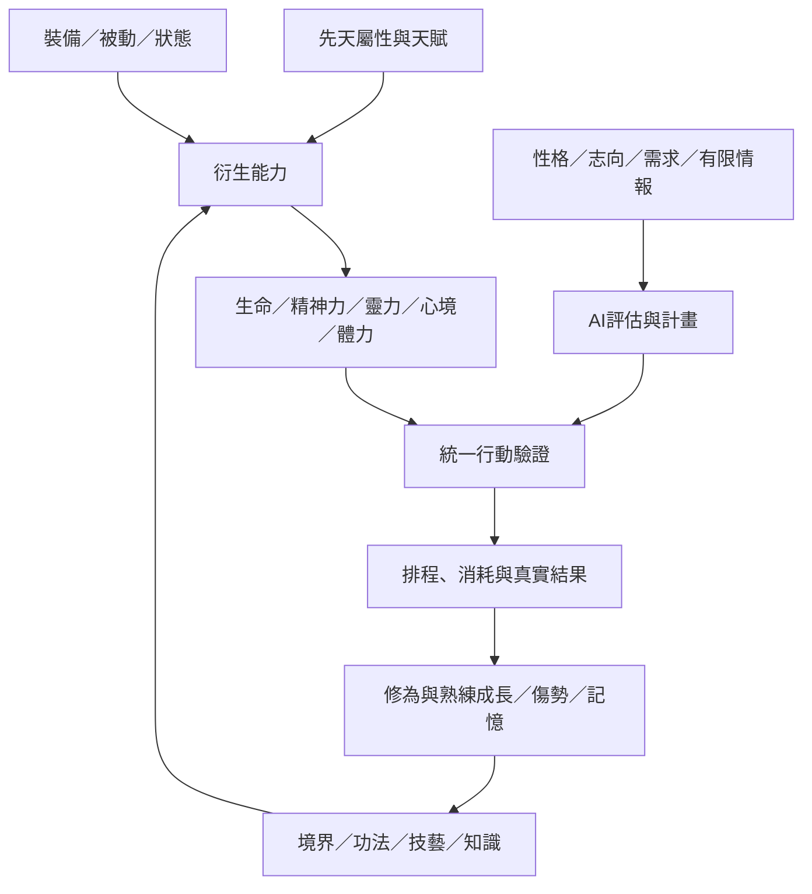

# 角色養成系統：屬性、技藝、裝備與技能方案

日期：2026-10-18。用途：依使用者草案補齊設計，區分已確認方向與候選規則。本次只規劃，不修改程式或數值。

後續戰鬥需求變更：失能後有10%額外生命，耗盡可死亡；未死亡者戰後重傷，未療傷再次參戰即失能。以下原先非死亡流程已由[雙陣地戰鬥方案](戰鬥系統_雙陣地回合制方案.md)取代；此變更尚未實作，永久性與玩家死亡後流程仍待確認。

## 1. 已確認與現況

戰鬥細則後續確認：溢出正常HP傷害的50%扣失能生命；重傷可回住處自己／他人耗藥療傷，或到醫館付靈石治療。玩家死亡可接管現有角色或結束重開；療程、費用、可接管資格等細則仍待訂，詳見戰鬥方案。

使用者提出生命、精神力、靈力、心境，後續新增體力；另有天賦／性格、性功／命功／炁功屬性、四類戰鬥技藝、九類生產技藝、知識、裝備與三類技能。另已確認：

- 生命歸0失能；後續確認有10%失能生命，耗盡可死亡。戰後存活者取得重傷debuff，未療傷再進戰鬥即失能；恢復方式另訂。
- 精神力歸0進入神智不清，隨機取得精神負面狀態。
- 體力上限100，只能休息回復；移動、製作、修煉、娛樂需要體力。低於30疲勞並降低養成收益，0時原地昏厥，休息到超過30才甦醒。
- 一般休息每Tick回30體力；昏厥後休息每Tick回10。露宿回復較少，住處、床及其他有效條件可增加回復，具體加成另訂。
- 技藝加成各自對應：武器→近戰、術法→法術、遠程→遠程、奇門→奇門，不沿用原文重複的跨類別加成。
- 寶物提供6格裝備位；技能以熟練度提升等級，分為心法、招式、技巧。

現有程式已有Health、Cultivation、Realm、單一功法／功法熟練、煉丹／採集熟練、武器及簡易攻防。`CharacterProgression.cs`推導能力，`CombatActions.cs`與`PartyCombat.cs`仍將戰鬥生命下限設為1。沒有精神力、靈力、完整狀態／天賦／人格系統，也沒有以下完整技能與裝備規則。

因此「HP可歸0並進入瀕死」需要改戰鬥結算與資格驗證；不能只加畫面欄位。既有驗收保留為舊範圍證據，不代表新方案已完成。

## 2. 建議整體分層



基礎屬性、衍生能力、當前資源、成長進度分開保存。修為不是技能熟練，境界不是所有技藝的共同等級；角色擅長煉丹也不等於擅長戰鬥。

## 3. 基本數值與恢復缺口

| 數值 | 已確認作用 | 需要補齊的規則／候選方案 |
|---|---|---|
| 生命HP | 0時瀕死，禁止戰鬥，戰後存活取得重傷 | Current／Max分開；體質影響上限。治療、休養與重傷移除分開，不把補滿HP當成痊癒 |
| 精神力 | 精神狀態，0時神智不清並隨機精神負面狀態 | 由精神屬性推上限；哪些行動消耗、如何恢復、恢復多少解除狀態均待訂 |
| 靈力MP | 使用技能消耗 | 由氣感及境界推上限與恢復；消耗時點、戰中／戰外回復、失敗／取消退還另訂 |
| 心境 | 影響修煉速度及熟練獲取 | 已確認0～100、初始50；修為及熟練倍率0.5＋心境／100，再乘疲勞；增減事件待訂 |
| 體力 | 上限100；移動、製作、修煉、娛樂需要體力；不足30疲勞、0昏厥 | 一般休息30／Tick，昏厥休息10／Tick；環境倍率與行動消耗待訂，不能以普通回MP替代 |

2026-10-18已確認心境測試規則，套用既有修為及熟練獲取；心境與疲勞倍率相乘後一次向下取整，不減少物品產量／成交收入／任務貢獻點。尚未有實作的技藝與屬性公式仍按原範圍逐項確認。

體力已由使用者明確新增，疲勞是其衍生狀態；飢餓、壽命不因此加入。體力休息不自動恢復生命、靈力或精神力，也不自動解除重傷。

### 體力、疲勞與昏厥（已確認方向）

體力固定上限100，當前值限制在0～100。是否允許天賦、裝備或境界增加上限未確認，首版不能擅自突破100。新角色初始體力與存檔遷移初值另訂。

| 體力／既有狀態 | 結果 |
|---|---|
| 30～100，且非昏厥 | 不因體力低於門檻而疲勞；仍須符合各行動成本與其他資格 |
| 大於0且小於30 | 疲勞，養成收益降低；並非直接禁止全部活動 |
| 歸0 | 進入昏厥，停止自主移動／工作／修煉／娛樂，原地休息 |
| 已昏厥，回復至10／20／30 | 仍昏厥，不能在回到30時提前解除 |
| 已昏厥，回復超過30 | 解除體力造成的昏厥，恢復是否可行動仍須檢查重傷、死亡等其他條件 |

已確認一般休息每Tick回30，昏厥休息每Tick回10。沒有環境修正時，0→10→20→30→40，需4Tick甦醒。每Tick以開始時的休息模式計一次回復；不能第4Tick甦醒後同Tick再追加一般休息的30點。

2026-10-18已確認首批每次移動／製作／採集／修煉／學習耗10，順序為「選擇行動→執行→扣除體力→體力歸0→下一Tick強制休息」。排程完成後才扣，旅行整段抵達後扣一次；成本不足先休息，不透支。0體力自動強制休息，不能再執行一般行動。娛樂具體活動另訂。

疲勞降低養成收益；已確認測試倍率為修為及相應熟練50%，不減實際物品產量。首批依結算時體力計算，整數向下取整；扣體力在產出與收益結算之後。

### 休息環境與回復方案

| 條件 | 已確認方向 | 尚待定內容 |
|---|---|---|
| 一般有效休息 | 30體力／Tick | 首批town／sect／alchemy，其他地點歸露宿 |
| 露宿 | 已確認15體力／Tick | 其他新增環境另訂 |
| 自己住處且有床 | 已確認45體力／Tick | 其他增益、疊加與床位系統另訂 |
| 昏厥原地休息 | 固定每Tick回10，超過30甦醒 | 已確認不受環境加成 |

候選公式：一般休息回復量由30加上有效環境修正，再夾到100上限；昏厥使用獨立的10點規則。加法或乘法、最低回復、修正上限與疊加順序皆需資料化。未在住處或無床使用權不能拿到加成，也不能為加成瞬間傳送回家。

體力成本於行動執行完成後扣除，因此本次成本不會中斷旅行或生產；歸0者在完成所在地從下一Tick強制休息。原「先扣體力、暫停工期續作」候選已由本規則取代，不重複產出或退還已消耗材料。

NPC可評估附近有效休息點與趕路成本，不應一律等體力耗盡才休息。住處、床與其組織使用權必須有實際資料來源。娛樂本身也需要體力，不能當作休息免費回體；娛樂種類及心境效果另訂。

死亡、戰鬥失能、重傷、精神異常與體力昏厥是不同狀態。2026-10-18已確認普通休息每Tick回10生命，僅非戰鬥且生命大於0，體力滿仍可休息至生命／體力雙滿；不耗丹。恢復體力／普通生命不會復活或治好重傷；戰鬥是否消耗體力、戰中昏厥是否按失能結算、能否戰中休息，須與戰鬥方案另訂。

固定Tick休息只在世界實際推進時結算，沿用關閉遊戲不離線推進的規則。存檔需保存體力、昏厥、休息模式與已結算Tick，避免讀檔刷新體力、洗掉昏厥或重算同Tick回復。

### 瀕死與重傷：原流程及新規格銜接

本節保留養成討論脈絡；追擊致死、失能生命與重傷禁戰以後續戰鬥方案為準，不再套用無死亡政策。

戰鬥中承受傷害 → HP扣至0 → 瀕死、立即移出可行動／可選攻擊者集合 → 其他隊員可繼續 → 戰鬥結束 → 存活結算並附加重傷。

- 瀕死不能繼續攻擊、放招或被當作正常戰力；不以反覆攻擊瀕死者延長戰鬥。
- 單人瀕死或全隊無法戰鬥須能結束戰鬥，不因禁止攻擊而永遠停在Active。
- 同時倒地、撤退結算、戰利品及任務勝負需明定；候選為同時無人能戰鬥時判平局，不硬判一方勝利。
- 戰後如何從HP0恢復到可休養狀態仍待確認。候選為最低1HP並保留重傷，避免現有「HP0拒絕所有行動」使角色永遠無法休養；這不是已定自動恢復量。
- 重傷可降低可用生命上限、攻防或工作效率，但具體效果、強度、療程與移除條件另訂。多次重傷是刷新、加深或多層，必須設定上限。
- 主動治療瀕死者能否讓其同場重新參戰尚待確認，不能因補1HP就無限起身刷行動。
- 普通玩家與NPC共用規則。副本怪物的失能／死亡／掉落與普通角色是否完全相同仍需確認；新方案已包含死亡，但不自行加入復活、繼承或屍體系統。

### 神智不清與精神負面狀態

建議只在精神力「由正值變為0」時抽取一次，而非每Tick重抽。以世界亂數、狀態來源與持續時間記錄，存讀不能洗掉或重抽。

候選狀態：恍惚（命中／工作精準降低）、驚懼（風險評估提高）、遲滯（施放／學習時間增加）。效果與機率均待訂；不自行加入永久精神損傷或讓玩家角色隨機傷害同伴。

神智不清解除與附帶負面狀態移除可分開；須訂恢復門檻避免在0／1之間反覆觸發。角色受影響仍走共用驗證，不讓AI直接繞過技能成本或控制其他人。

## 4. 基本屬性：補齊兩個待定欄位

2026-10-18使用者已確認神識與意志名稱；神識對應靈魂施放速度、意志對應靈魂防禦。數值係數及其他兼用效果仍待確認。

| 分類 | 屬性 | 對應衍生能力 | 邊界 |
|---|---|---|---|
| 性功（靈魂） | 智力 | 靈魂攻擊 | 不直接取代悟性或所有學習速度 |
| 性功 | 精神 | 精神力上限 | 屬性值與當前精神力分開 |
| 性功 | **神識** | 靈魂施放速度 | 若也用於偵察，偵察範圍與情報來源需另訂 |
| 性功 | **意志** | 靈魂防禦／精神異常抵抗 | 與動態心境區分；是否兼異常抵抗待訂 |
| 命功（肉體） | 力量 | 物理攻擊 | 武器／招式係數再決定實際傷害 |
| 命功 | 敏捷 | 行動速度 | 首版建議先定義行動間隔，不同時無限制加命中、閃避、暴擊 |
| 命功 | 體質 | 生命上限 | 是否影響自然恢復、物理防禦另訂 |
| 炁功（修仙能力） | 感應 | 修煉效率 | 對應修為增長，不自動加全部生產收益 |
| 炁功 | 氣感 | 靈力上限／回復 | 上限與回復速率分別配置係數 |
| 炁功 | 悟性 | 學習、技能熟練／領悟 | 領悟事件要有資格、實際機率與可追溯結果 |
| 炁功 | 氣運 | 指定正向事件機率與負面事件豁免 | 不是每個隨機判定都自動套用，不能憑空補發資產 |

重要缺口：法術攻擊與法術防禦由什麼推導？建議先區分物理／靈力／靈魂三種傷害；靈力攻防使用境界、功法與對應屬性配置，不新增一組未定的基礎屬性。具體由氣感、悟性或其他因素主導，需確認。

速度也要分清「世界旅行速度」「戰鬥行動間隔」「施放前搖」「生產工期」。敏捷／神識不應一律縮短這四類時間，否則會直接改寫交通與經濟平衡。

## 5. 推導與成長公式候選

所有係數、上下限與曲線放設定；以下是計算結構，不是已確認數值：

```text
生命上限 = 境界基值 + 體質係數×體質 + 裝備平值，再套狀態修正
精神力上限 = 基值 + 精神係數×精神 + 有效增益
靈力上限 = 境界基值 + 氣感係數×氣感 + 有效增益
物理攻擊 = 基值 + 力量成長 + 境界／武器／招式對應加成
靈魂攻擊 = 基值 + 智力成長 + 對應功法／技能加成
修為增量 = 活動基值×感應修正×心境修正×有效心法修正
熟練增量 = 有效實作基值×悟性修正×活動心境修正×對應天賦修正
施放時間 = 基礎前搖÷有界速度修正，按固定Tick規則量化
```

建議先加平值、再合併同類百分比、最後乘不同類修正，統一取整並Clamp。防止裝備／被動各乘一次導致指數膨脹；避免浮點分數不一致導致同種子續跑分歧。

更換裝備只改上限／能力，不自動補滿當前資源；上限降低則夾到新上限，重新穿回不能免費回血回藍。永久成長與暫時增益分開，卸下裝備不扣回已合法學會的技能，但技能能否使用仍可檢查當前條件。

屬性來源候選為出身／先天初值、境界成長及明確訓練。不自行增加自由配點、洗點、血脈或轉生系統。修為、境界突破與丹藥消耗應沿用並遷移既有規則，不另外複製一套角色等級。

## 6. 天賦、性格、志向的區別

| 項目 | 定義 | 候選用途 |
|---|---|---|
| 天賦 | 先天取得的能力增益 | 煉丹成功、對應熟練獲取、資源上限等；來源與倍率資料化 |
| 性格 | 決策傾向，可附帶指定增益／減益 | 勤奮提高生產動機；勇敢提高風險承受；膽小偏好避戰／組隊 |
| 志向 | 長期追求目標 | 延續均衡、求財、丹道、修煉、戰鬥的Utility權重 |

勤奮的「更想工作」與「工作更快」是不同效果，不能只調一次權重便宣稱兩者都有。勇敢不等於忽略瀕死限制，膽小也不一定完全不能戰鬥。

建議性格是可共存的標籤／強度，衝突組合需有限制，例如勇敢與膽小不能同時滿強度。增益顯示來源，避免同一效果在天賦、性格與志向重複計算。先天取得方式、可有幾項及性格是否能改變，仍待確認。

## 7. 技藝：學習門檻與效果分開

### 戰鬥技藝

| 技藝 | 門檻用途 | 加成對象 |
|---|---|---|
| 武器 | 學習近戰武器招式 | 近戰武器技能 |
| 術法 | 學習法術 | 法術技能 |
| 遠程 | 學習遠程招式 | 遠程技能 |
| 奇門 | 學習對應特殊技法 | 奇門技能 |

「門檻達標能學」與「熟練增加效果」分開。技能以Tags／ScalingCategory指定對應類別，混合技能的加成比例另訂，不把四項全疊。奇門包含暗器、機關或其他哪些範圍仍需定義；不因此自動新增全部戰鬥類型。

### 生產技藝

| 技藝 | 對應作用候選 | 現況／缺口 |
|---|---|---|
| 煉丹 | 配方門檻、成功率、熟練效果 | 已有部分規則，需整合新模型 |
| 醫術 | 治療資格、療程與傷勢恢復 | 重傷恢復尚未定，不先承諾直接治好 |
| 鍛造 | 一般武器／防具製作 | 建議與附靈煉器區分，配方及材料未定 |
| 煉器 | 法器／寶物等特殊裝備 | 寶物功能、成本與成功規則待定 |
| 符籙 | 符紙類消耗品 | 消耗來源與施放規則待定 |
| 陣法 | 陣法學習、布設與維護 | 占地、啟動成本及效果範圍待定 |
| 御獸 | 馭獸資格與能力 | 妖獸個體、指令權與消耗待定 |
| 採集 | 取得條件、耗時與熟練效果 | 已有採藥，保持資源池與產出來源 |
| 種植 | 種植資格、週期與產出 | 既有待確認功能，不因列為技藝而立即加入 |

每項技藝保存熟練值，由門檻表推導等級；配方品質、失敗損失與成功率要實際結算。失敗是否給部分熟練待訂。對無效操作、零材料、重複交付、攻擊已倒地對象不能無限刷熟練。

技能熟練與技藝熟練可以同時增長，但分別有來源與上限，不把同一次事件重複記帳。悟性影響學習不直接保證一次生產成功。

## 8. 知識與書籍

知識是角色已理解的內容，書籍只是載體。建議流程：取得可讀來源／圖書權限 → 檢查前置知識與能力 → 排程閱讀／理解 → 完成後記錄KnowledgeId及來源 → 啟用對應增益或解鎖。

- 保存「已理解知識」而非只檢查是否持有書；讀完後轉讓書籍不會自動忘記。
- 相同KnowledgeId不重複疊加增益；重讀是否提升理解深度另訂。
- 書可重複使用或讀完消耗由道具定義決定，不預設所有書消失。
- 解鎖配方／技能學習資格不等於直接學會技能或獲得成品。
- NPC透過實際見聞、購書或有權使用的藏書得知資訊，不從全域知識表取得所有秘方。

## 9. 裝備與六格寶物

已確認分類：武器、防具、配飾、寶物；寶物**6格**。其他分類槽位數未確認，候選可先武器1、防具1、配飾數量另訂，不把寶物6格誤套成總裝備只有6格。

必要規則：唯一裝備實例ID、持有者、可裝備類別、前置條件、被動／主動效果、是否允許重複裝備、戰中更換與綁定限制。裝備本身仍在統一物品／庫存模型內，被裝備的物品不能同時交易或裝在兩格。

寶物可有特殊功能，但需逐件確認：例如提供指定被動或一項有消耗的主動招式。不同寶物同名效果是否疊加、主動效果冷卻是否共享，需明確定義；不因6格而預設六個效果無限制相乘。

耐久、套裝、品質、強化與裝備破壞屬後續候選，沒有因本次分類而全部授權。防具／配飾效果應能在角色面板追溯來源。

## 10. 技能：心法、招式、技巧

| 類型 | 核心用途 | 需確認的限制 |
|---|---|---|
| 心法 | 影響修煉速度並提供增益 | 可同時修幾種、主修／輔修、是否須運轉、與現有MethodId關係 |
| 招式 | 主動技能 | 靈力／精神消耗、前搖、冷卻、目標、射程、施放中斷與結果 |
| 技巧 | 可包含被動與主動效果（2026-10-24更新） | 常駐或條件觸發、主動成本、觸發頻率、是否占裝配位、疊加規則 |

建議每個技能保存獨立SkillId、熟練XP與解鎖狀態，由配置推導技能等級。2026-10-24新增[功法系統方案](功法系統_技能標籤與熟練方案.md)：青雲功與柳溪訣已指定修練來源及效果；技能各自或整套共用熟練、戰鬥使用是否增加熟練、每次收益與層級對應仍待確認，以新方案記錄為準，不由舊候選規則自行推定。

候選招式流程：驗證資格／目標／資源 → 保留消耗與排程 → 施放完成／中斷 → 實際結算消耗、命中、傷害或效果 → 冷卻與熟練。資源在起手或完成時消耗、取消是否退回由定義決定，不能同時扣兩次。

反應型技巧要避免無限互相觸發。技能冷卻、持續增益與資源回復都按固定Tick，不依動畫幀率；遠方批次戰鬥仍須得到相同個體結果。

## 11. 氣運與亂數範圍

建議事件定義標記是否受氣運影響，再以有界修正改變機率；負面事件豁免另作可追蹤判定。實際公式、上限及正負事件定義尚待確認。

不能一律提高所有好事、壓低所有壞事，造成必定成功或永不受傷。不得豁免交易付款、原料扣除、任務期限等確定規則；若豁免某事件，須記錄原事件與豁免原因，不自行追加沒有來源的戰利品。玩家與NPC使用同一規則、亂數狀態與事件順序。

## 12. 資料化、存檔與AI接線

建議新增設定分類（本次尚未建立）：`config/characters/attributes.json`、`resources.json`、`talents.json`、`personalities.json`；`config/skills/`、`config/knowledge/`、`config/equipment/`及`config/status/`。

核心角色資料宜拆出BaseAttributes、ResourceState、TraitState、ProficiencyState、LearnedSkills、Knowledge及EquipmentLoadout等聚合，不將數十項可變欄位散落UI。衍生值由統一計算器產生，展示層不維護第二套公式。

狀態資料至少包含DefinitionId、來源、開始／結束Tick、層數與所需亂數結果。派生上限、資源當前值、技能冷卻／施放中排程、裝備實例及熟練來源都需可存讀並重現。

舊檔生命是0～100固定值，新上限導入時要確認按比例換算或保留絕對值；不可悄悄補滿。舊武器／功法與熟練須明確映射，新增精神／靈力初值記錄遷移預設，來源檔不覆寫。新建世界才套用最新平衡設定。

AI新增自身資源與狀態需求，再評估休養、回靈、學習、裝備與風險；不強迫所有人按一套成長路線。尤其需驗證生產／交付仍可選，不能讓新修煉權重進一步壓住狼皮返宗等既有經濟行為。

## 13. 建議實作順序與驗收

已依2026-10-18使用者指示納入**階段6**，統一進度見[開發進度總表](../開發進度/開發進度總表.md)的6-01～6-15。下列GROW編號保留為原方案索引，不另維護第二份狀態；本次僅規劃、尚未實作，不重開原階段3。

| 原方案索引 | 正式階段工作 |
|---|---|
| GROW-01 | 6-01～02 資料與派生屬性 |
| GROW-02、GROW-02-S | 6-03～04 體力與共用狀態；戰鬥失能觸發移交7-06 |
| GROW-03 | 6-08 技能／資源契約，戰場執行接7-05 |
| GROW-04 | 6-05 心境、修為與熟練 |
| GROW-05 | 6-06～07 天賦／性格與戰鬥技藝 |
| GROW-06 | 6-09～10 裝備與知識 |
| GROW-07 | 6-11 九類生產技藝分批接線 |
| 補齊整合工作 | 6-12療傷、6-13氣運、6-14 AI／UI、6-15遷移與回歸 |

階段6定義跨活動的狀態與療傷規則；雙陣地內的HP0／失能生命／死亡觸發由階段7完成，避免循環相依。先完成已確認的基礎切片，其餘未定係數／配方仍須確認，不能以原型或空欄位結案整階段。

| 編號 | 範圍 | 完成條件 |
|---|---|---|
| GROW-01 | 基礎屬性與統一派生計算 | 配置合法、上下限、效果來源、裝備反覆切換不補資源 |
| GROW-02 | 資源與瀕死／精神狀態 | HP0退出戰力、戰鬥可結束、精神歸0只抽一次、恢復／存讀一致 |
| GROW-02-S | 體力與休息 | 上限100、行動成本定案後共用驗證、低於30疲勞、0昏厥／超過30甦醒、30／10回復與環境權限、途中休息及存讀去重 |
| GROW-03 | 靈力與技能成本 | 消耗不足拒絕、冷卻／施放排程、防重扣與中斷結算 |
| GROW-04 | 心境、修為與熟練 | 分活動倍率、門檻升等、無效動作不刷經驗、同種子可重現 |
| GROW-05 | 天賦／性格／戰鬥技藝 | 分清AI偏好與能力加成、四類各自對應、玩家NPC規則一致 |
| GROW-06 | 裝備與知識 | 寶物6格、持有／裝備一致、閱讀完成與去重、舊資料遷移 |
| GROW-07 | 生產技藝逐項接線 | 先整合已有煉丹／採集，其他技藝各自配方／成本／功能確認後再做 |

建議先用「受傷退出戰鬥→重傷→休養／醫療」「靈力不足→恢復→施放」「閱讀→學會→實作熟練」三條流程驗證；其中恢復規則先定案再實作，不以空技能／假狀態宣稱完成。

必要回歸包含組隊個別瀕死／撤退、雙方倒地、真實戰利品、任務及俸祿／交付、宗門庫存、同Tick重複指令、途中存讀、遠方戰鬥及既有場景控制權。NPC數量壓測必須另有實測，不沿用舊Headless成績保證新系統容量。

## 14. 待確認與本次交付

優先問題見[角色養成待確認問題](角色養成系統_待確認問題.md)。本次已確認重傷是debuff、四類技藝各自加成；神識／意志名稱及首批心境規則已確認並追蹤階段6；資源恢復、重傷效果、傷害分類、屬性係數及技能裝配限制仍是候選。

本次僅文件與進度更新，未改程式、設定、存檔或現有平衡，未執行程式建置／測試；新養成系統未驗證。


2026-10-18生活系統分工更新：使用者新增凡人技能（醫術、製藥、鍛造、畜牧、種植、採集）及修仙技能（煉丹、煉器、符籙、陣法、御獸，生產消耗靈力），優先醫術／製藥／鍛造。此分類取代舊九類技藝概括；現有煉丹／採集不擅自重寫。詳見[生活系統方案](生活系統_醫術製藥與鍛造方案.md)。數值、品質、藥效時鐘與首批相依範圍待確認；本次只更新規劃，未修改程式或驗證。

生活首批已依追加確認接線：三技藝每100熟練升級；醫術普通治療與獨立重傷療程分開，3草＋1膏／5Tick解除重傷並回20；藥膏40、止血散10×5並區分輪末／世界Tick；逐件品質武器與防具可穿戴。只在新生活測試啟用，完整死亡流程仍另依階段7。見[首版與驗收](生活技能首版_實作與驗收.md)，不把一般生命回復視為解除重傷。

## 凡人修為後續規劃（2026-10-18）

使用者新增凡人→修真→化神→成仙、三功分帳／屬性訓練、每十點一重／需求1.2倍與1%得炁方向；詳見[凡人三功與得炁方案](修為系統_凡人三功與得炁方案.md)。本次只規劃，候選門檻、點數解釋與抽取時點待確認，不開啟原耗丹行動，不自行實作後三階段。

### 凡人修為確認補記（2026-10-18）

上述凡人修為三題已獲使用者確認，取代先前待答註記：自動增加訓練屬性1點、不另給自由點；各功累計等級每10級一重，基值100、每重需求乘1.2；入門經驗滿後從下一次完成打坐起獨立抽1%，成功只解鎖感炁且正式經驗從0，暫無保底。其他候選規則仍待確認；僅更新方案，未實作。

凡人修練成本後續確認：每次1點體力換1點經驗；初始100沿用升級需求基值，體力初始100不變，不預先給100經驗。取代原10體力／20經驗候選。工期／AP未定；與心境疲勞倍率及小數累積的關係列待確認，避免每次1×0.5向下取整永遠為0。僅規劃文件，尚未實作。

凡人修為階段歸屬更新：使用者指定移至階段8（8-01～09），見[階段8計畫](階段8_凡人修為開發與驗收計畫.md)。原階段6補充MORTAL-01停止獨立追蹤；階段6仍負責共用屬性／體力／心境與其他既有養成項目。
