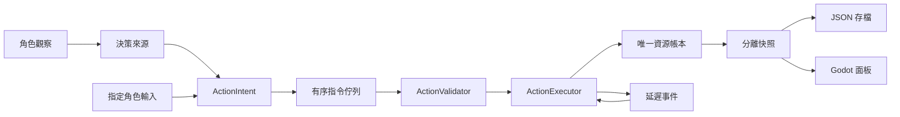

# 階段 0：架構、交付及驗收紀錄

2026-10-17 更新：本機已可建置純 C# solution（0 警告／0 錯誤），原 12 項驗收全數通過；加上階段 1 測試為 16/16 passed。下方環境缺失是初次交付的歷史紀錄。Godot 展示層仍未驗證，故不宣稱階段 0 全項驗收完成。階段 1 實作與限制見 `階段1_自主循環與驗收.md`。

日期：2026-10-16。使用者已確認階段 0 提案；只實作本階段，不擴張自主生產玩法。

## 模組與資料流

- `Domain` 不參考 Godot；`Simulation` 參考 Domain；AI 只參考 Domain；Persistence 參考 Simulation；Headless／Presentation 組裝模組。
- `WorldState` 是可序列化 DTO。引擎建構、每次提交 Tick 及對外快照均複製資料；外部更改 DTO 不會改動 live world。
- `CharacterState`、`OrganizationState` 階段 0 只有 ID 與名稱，能力與需求留待階段 1；`Inventory` 從帳本推導餘額，無第二份資產狀態。
- `SimulationTick` 定義整數 Tick 值型別；`GameClock` 保存 Tick 與每 Tick 模擬秒數，目前預設 60 秒，為骨架設定而非已定案的遊戲平衡。
- 僅提供資源轉移行動，用於驗證管線；不是市場成交，也沒有產出假丹藥或假自主循環。

## 提交與時間

`Submit` 在鎖內編序；`Step` 在私人副本依序執行：時鐘加一 → 到期排程（到期 Tick、序號）→ 指令（序號）→ 完整性驗證 → 更換世界狀態。例外不會留下半完成 Tick。

相同 Tick 的到期事件先於新指令。沒有額外優先序種類，故目前使用固定同級優先序。多執行緒可排隊，但執行順序由實際取得的序號決定；跨次重現需要相同輸入順序，不能只靠亂數種子。

`ActionValidator` 統一檢查控制權、角色、接收者、資源、數量、餘額、時間與接收容量；延遲入帳也計入容量預留。`DecisionSource` 是可信本機 adapter 標記，非網路權限憑證。拒絕過的意圖 ID 也不可再用；修正意圖時使用新 ID。

延遲轉移先移入 `$escrow:<意圖ID>`，到期轉入目標，杜絕等待期間重複消費。`$genesis` 僅記錄 Tick 0 初始資產來源。取消、配方、生產失敗與多人交易留待後續階段。

Godot 每 250ms 實際累積時間推進一個 Tick，使用 `TickPump` 而非畫面幀數；每次最多處理 32 Tick，剩餘時間保留，不丟棄。暫停期間不累積。此 250ms 是展示預設，不是離線推進規則；本骨架關閉程式後不推進。

## 重現與存檔

- 使用明確演算法的 `SeededRandom`，零種子正規化為 1；可從完整狀態繼續。階段 0 僅用於生成測試初始資產，行動本身不抽取亂數。
- JSON schema 版本 1 保存世界時間、亂數狀態、資產帳本、事件、待提交意圖、排程、去重 ID 與下一序號。未來 NPC 記憶與計畫加入模型後須一起保存；目前尚未實作。
- 不支援版本遷移，非版本 1 拒絕載入。載入亦驗證已知帳戶、負庫存、事件序號及排程保留款一致性。
- 在相同目錄寫入隨機暫存檔、flush 後移至未存在的目標；不覆寫現有存檔。檔案內容驗證不等同防作弊簽章。
- SHA256 為此 schema 與固定序列順序下的快照摘要；不是跨未來版本的標準化內容雜湊。

## 驗收案例

執行 `dotnet run --project tests/Acceptance`，目前包含：

1. 同角色、同資源條件，調整指定角色後，玩家／NPC 經同一規則得到相同帳本與拒絕原因。
2. 玩家不能操作其他 NPC；NPC adapter 不能操作指定玩家角色。
3. 重複意圖及超額扣款不會重複轉移或形成負庫存。
4. 延遲行動立即保留資源，不提前交付，且僅完成一次。
5. 並行提交競爭全部餘額，只允許一筆成功，不要求排程勝出者固定。
6. 零數量、負數量、未知收款人不改變資產帳本；接收容量檢查包含延遲保留款，避免整數溢位。
7. 修改建構輸入或對外快照不影響 live world。
8. 相同累積時間、不同畫面頻率得到相同 Tick 與世界摘要。
9. 固定種子及有序輸入重現；亂數狀態可續接。
10. JSON 存讀檔保留待提交、排程及去重資料；續跑一致；既有檔案不覆寫。
11. 不相容版本、負庫存與孤立保留款遭拒。
12. NPC 測試決策來源僅依觀察回傳意圖。

實際結果：**未驗證**。`dotnet build src/Headless/Headless.csproj` 因環境沒有 .NET SDK 而無法啟動；另無 PATH 可用的 Godot。未執行編譯、驗收程式、Godot UI 或效能量測，不能標記階段 0 驗收完成。

## 限制與下一步

帳本餘額查詢與完整性驗證採線性掃描，每 Tick 複製世界；事件與去重 ID 尚未裁剪。這些選擇只適用小型骨架，不代表支援 10,000 NPC。無效能容量承諾或實測數字。

尚無 Utility AI、GOAP、需求、技能、記憶、區域市場、生產、戰鬥、組織任務、2D 地形或 AI LOD。`TransferProbe` 明確為管線測試用途。沒有預先建立空白 Systems 方法來宣稱功能完成。

下一步先具備 .NET 8 SDK 與 Godot 4.3 .NET 環境，執行 README 的建置、驗收與展示操作；通過後才標記階段 0 完成。階段 1 依序做資料模型／採集 → 煉丹 → 有限資產交易 → 修煉成長 → Utility／短步規劃 → 40 NPC 整合驗收。開工前確認市場機制及離線時間規則，不擴張至宗門任務。
